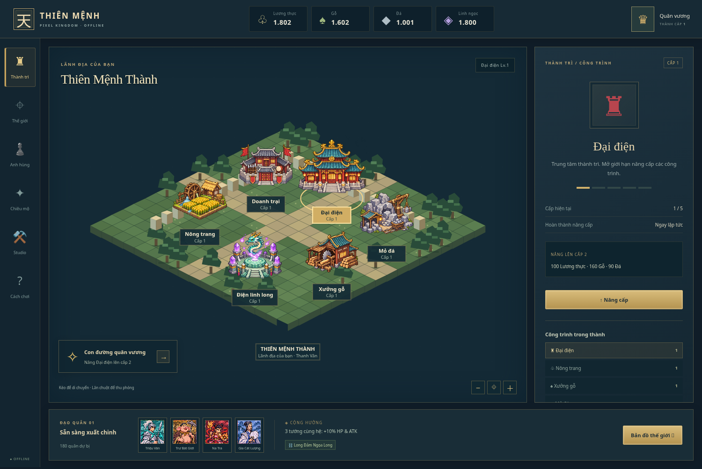

# Game-studio

Personal game studio · **Thiên Mệnh — Pixel Kingdom v2**

Game chiến thuật pixel 2D tiếng Việt, chơi offline trên Windows. Lấy cảm hứng từ vòng chơi xây thành, đội 4 anh hùng nguyên tố và linh long hỗ trợ của Infinity Kingdom, với nhân vật và luật phối hợp riêng dựa trên Tam Quốc, Tây Du Ký, Phong Thần. Đây là prototype PvE độc lập, chưa có liên minh, PvP hoặc thế giới MMO.



## Tải và chơi trên Windows

Mở [Thien-Menh-Kingdom-v2-Windows.zip](Thien-Menh-Kingdom-v2-Windows.zip) trên GitHub → **Download raw file** (biểu tượng tải xuống) → **Extract All… / Giải nén tất cả**.

- **Không cần cài gì:** nhấp đúp `CHOI-NGAY.bat`; trình khởi động tìm Microsoft Edge/Google Chrome để tránh mở HTML nhầm bằng VS Code. Hoặc kéo `Thien-Menh.html` vào trình duyệt.
- **Dùng Python 3:** nhấp đúp `CHAY-BANG-PYTHON.bat` hoặc chạy `py -3 chay_game.py` / `python chay_game.py` trong thư mục giải nén. Không cần pip. Máy chủ chỉ chạy trên máy bạn, mặc định cổng 8765; Ctrl+C để dừng.
- ZIP chứa sẵn hình ảnh và logic. Người chơi không cần Node.js, Internet, API key hoặc tài khoản.

Vào **Cách chơi** trong game để đọc hướng dẫn. Bắt đầu bằng nâng Đại điện, nâng Doanh trại, rồi đưa đội đến trại Hoàng Cân trên Thế giới. Muốn thử đủ kỹ năng, chọn **Studio → Mở 8 tướng để thử nghiệm**.

## Bản v2 có gì

- Thành trì isometric pixel tương tác: 6 công trình, nâng cấp cấp 1–5, sản xuất lương/gỗ/đá, huấn luyện quân.
- Bản đồ kéo/thu phóng: 3 trại PvE và 3 điểm tài nguyên; hành quân, thu thập và trở về.
- Đội 4 tướng: xếp tiền phong, cộng hưởng nguyên tố, kỹ năng riêng cho cả 8 nhân vật.
- 4 liên kết điển tích: buff toàn đội và đòn phối hợp thực sự trong chiến đấu.
- Hỏa long gây sát thương, Thủy long hồi HP, Mộc long tạo khiên theo chu kỳ 10 giây.
- Giao chiến tự động theo từng giây, nộ khí, tự/thủ công dùng chiêu, tạm dừng, rút quân; hiệu ứng kỹ năng riêng trên bản đồ và giao diện.
- Gacha mô phỏng, bảo hiểm SSR, chỉnh HP/ATK, xuất/nhập bản lưu.

Chi tiết chỉ số và giới hạn nằm trong [thiết kế](docs/game-design.md). Chân dung và công trình là ảnh pixel tĩnh; có hiệu ứng chiêu/hành quân, chưa có sprite nhân vật toàn thân nhiều khung hình.

## Tiến độ

Game lưu trên trình duyệt mỗi 5 giây. Vào **Studio → Xuất bản lưu JSON** trước khi đổi máy, đổi trình duyệt, đổi cách chạy hoặc cổng Python. HTML trực tiếp và máy chủ Python có vùng lưu riêng; dùng nhập JSON để chuyển tiến độ.

Bản lưu v1 được chuyển sang v2, giữ tướng, linh ngọc và chỉ số chỉnh tay; đội cũ lấy 4 tướng đầu. Bản lưu v2 thu hồi đạo quân đang đi và trả quân về thành khi tải lại; trận đang chạy không được lưu. Sản xuất tài nguyên tích lũy tối đa 8 giờ khi đóng game. Không dùng InPrivate/Incognito để giữ tiến độ lâu dài.

## Phát triển cùng Codex

Node.js 22+, không cần cài thư viện:

```sh
npm test
npm run dev
```

Máy chủ phát triển dùng cổng 3000. `game.mjs` giữ roster/gacha và logic v1 để tương thích; `kingdom.mjs` xử lý gameplay v2; `map.mjs` vẽ bản đồ; `app.mjs` xử lý giao diện. Đọc [AGENTS.md](AGENTS.md) trước khi sửa.

Tạo lại gói Windows sau khi sửa:

```sh
npm run build:offline
python package-windows.py
```

Lệnh đầu nhúng toàn bộ mã và 3 PNG vào HTML độc lập. Lệnh sau tạo ZIP Windows/Python mới và cập nhật ZIP tương thích `Thien-Menh-Windows-Python.zip`. Python chơi game dùng hoàn toàn thư viện chuẩn. `.bat` chỉ được kiểm tra nội dung trên Linux; cần thử thực tế trên Windows.

Game không gọi AI khi chơi và không cần dịch vụ trả phí. Chi phí Codex/hosting nếu có tùy gói của bạn. Studio hỗ trợ Codex bằng hướng dẫn trong kho, chưa khởi chạy/điều phối Codex từ trình duyệt. Quy trình studio gọn lấy cảm hứng từ [Claude Code Game Studios](https://github.com/Donchitos/Claude-Code-Game-Studios), không chuyển nguyên bộ agent/hook riêng của Claude.
