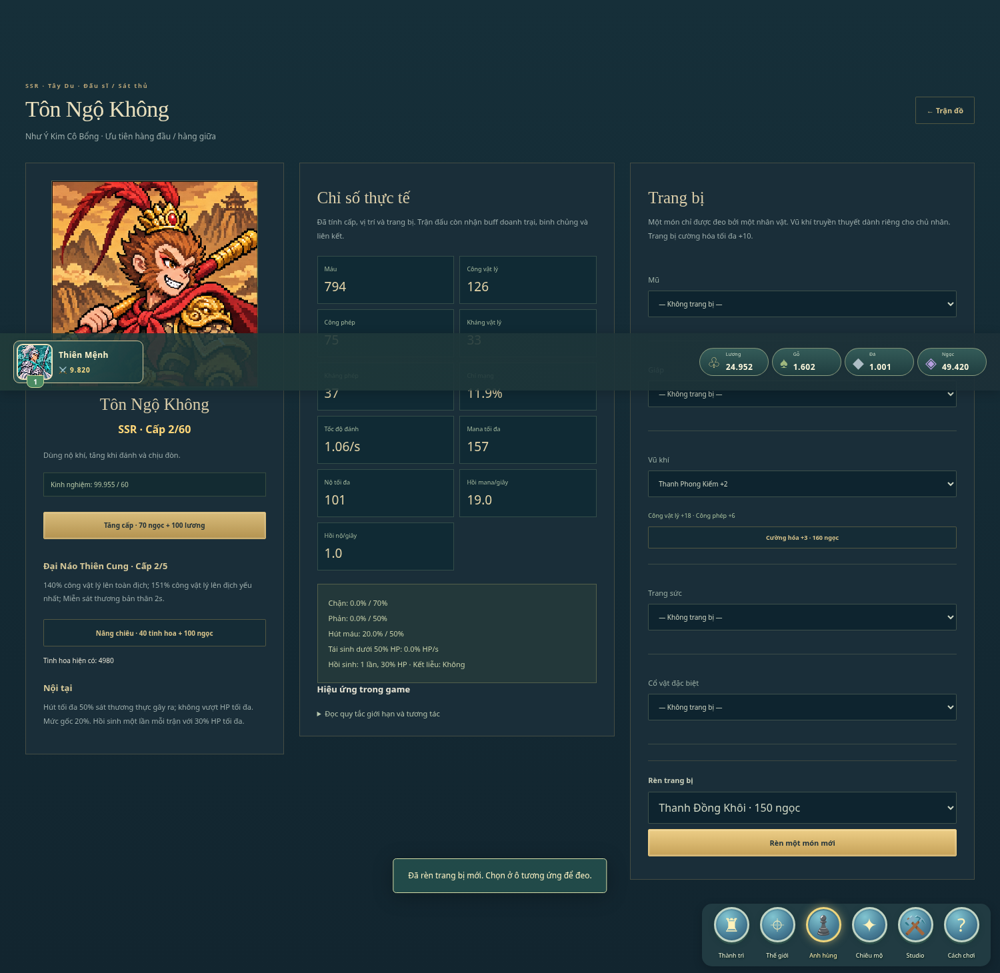
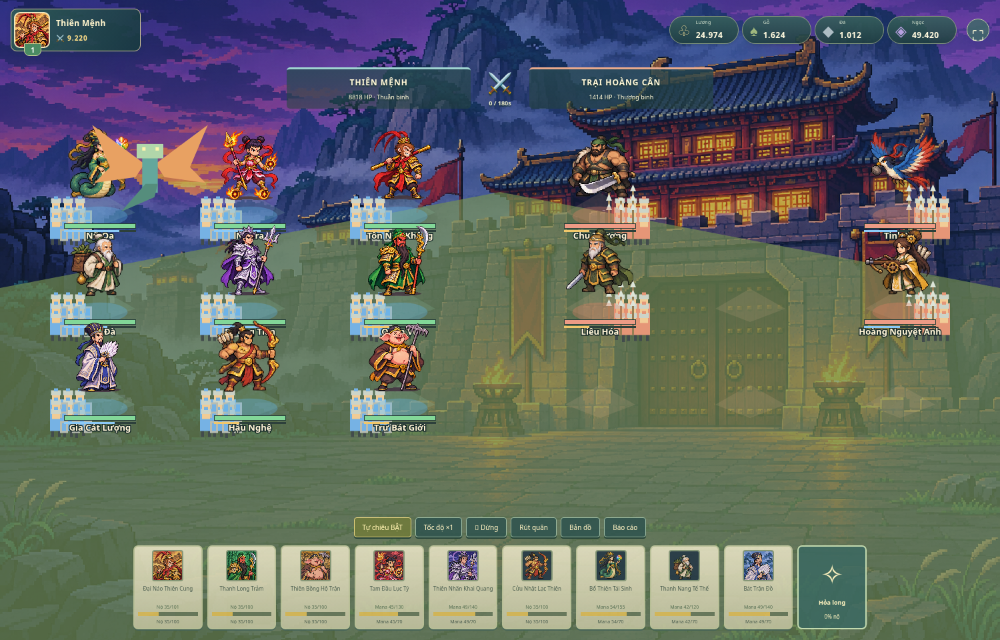
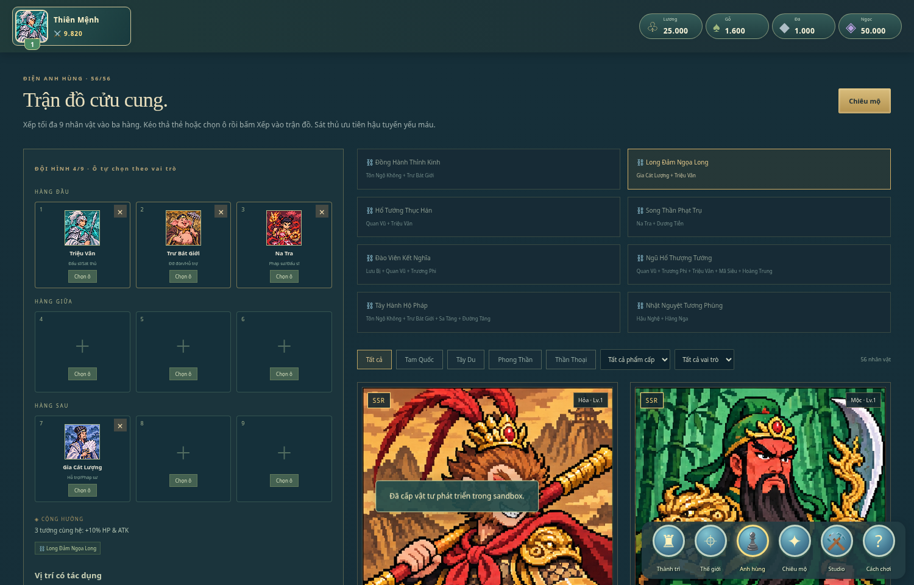

# Game-studio

Personal game studio · **Thiên Mệnh — Pixel Kingdom v4**

Game chiến thuật pixel 2D tiếng Việt, chơi offline trên Windows. Lấy cảm hứng từ vòng chơi xây thành, đội 4 anh hùng nguyên tố và linh long hỗ trợ của Infinity Kingdom, với nhân vật và luật phối hợp riêng dựa trên Tam Quốc, Tây Du Ký, Phong Thần. Đây là prototype PvE độc lập, chưa có liên minh, PvP hoặc thế giới MMO.





## Tải và chơi trên Windows

Mở [Thien-Menh-Kingdom-v4-Windows.zip](Thien-Menh-Kingdom-v4-Windows.zip) trên GitHub → **Download raw file** (biểu tượng tải xuống) → **Extract All… / Giải nén tất cả**.

- **Không cần cài gì:** nhấp đúp `CHOI-NGAY.bat`; trình khởi động tìm Microsoft Edge/Google Chrome để tránh mở HTML nhầm bằng VS Code. Hoặc kéo `Thien-Menh.html` vào trình duyệt.
- **Dùng Python 3:** nhấp đúp `CHAY-BANG-PYTHON.bat` hoặc chạy `py -3 chay_game.py` / `python chay_game.py` trong thư mục giải nén. Không cần pip. Máy chủ chỉ chạy trên máy bạn, mặc định cổng 8765; Ctrl+C để dừng.
- ZIP chứa sẵn hình ảnh và logic. Người chơi không cần Node.js, Internet, API key hoặc tài khoản.

Vào **Cách chơi** trong game để đọc hướng dẫn. Bắt đầu bằng nâng Đại điện, nâng Doanh trại, rồi đưa đội đến trại Hoàng Cân trên Thế giới. Muốn thử đủ kỹ năng, chọn **Studio → Mở 8 tướng để thử nghiệm**.

## Bản v4 có gì

- Thành phố chiếm toàn màn hình: HUD tài nguyên, nút nổi và bảng công trình chỉ mở khi chọn; dân cư đi trên phố, có kéo/thu phóng.
- 6 loại công trình, 4 doanh trại Thuẫn/Thương/Cung/Kỵ; xây dựng và huấn luyện có bộ đếm thời gian, tăng tốc xây dựng bằng 50 ngọc mô phỏng.
- Mỗi binh chủng có quân số, buff và khắc chế riêng; xuất chinh cần 60 quân cùng loại.
- Bản đồ kéo/thu phóng: 3 trại PvE và 3 điểm tài nguyên; hành quân, thu thập và trở về.
- Đội tối đa 9 tướng theo đội hình 3×3: đầu / giữa / sau; kéo thả để đổi vị trí, cộng hưởng nguyên tố và kỹ năng riêng cho cả 56 nhân vật.
- 4 liên kết điển tích: buff toàn đội và đòn phối hợp thực sự trong chiến đấu.
- Hỏa long gây sát thương, Thủy long hồi HP, Mộc long tạo khiên theo chu kỳ 10 giây.
- Sân đấu toàn màn hình: nhân vật pixel toàn thân, binh lính, đạn/đòn đánh, HP/nộ và hiệu ứng riêng. Có tự/thủ công tung chiêu, tạm dừng, tốc độ ×1/×2, rút quân.
- Sát thương vật lý/phép, giáp/kháng phép, bạo kích, khiên và sức mạnh giảm theo lượng HP/lực lượng còn lại; có báo cáo sau trận.
- Gacha mô phỏng, bảo hiểm SSR, chỉnh HP/ATK, xuất/nhập bản lưu.

Chi tiết chỉ số và giới hạn nằm trong [thiết kế](docs/game-design.md). Chân dung, công trình và sprite toàn thân là ảnh pixel tĩnh; có chuyển động/hiệu ứng canvas, chưa có hoạt ảnh nhân vật nhiều khung. Xem [mô hình sát thương](docs/damage-model.md) và [nguồn tham chiếu](docs/reference-analysis.md). Công thức là thiết kế của bản thử, chưa được xác minh là công thức nội bộ Infinity Kingdom.

## Tiến độ

Game lưu trên trình duyệt mỗi 5 giây. Vào **Studio → Xuất bản lưu JSON** trước khi đổi máy, đổi trình duyệt, đổi cách chạy hoặc cổng Python. HTML trực tiếp và máy chủ Python có vùng lưu riêng; dùng nhập JSON để chuyển tiến độ.

Bản lưu v1 được chuyển sang v2, giữ tướng, linh ngọc và chỉ số chỉnh tay; đội cũ được chuyển sang bàn 9 ô. Bản v4 vẫn tương thích định dạng lưu v2; bản v2 cũ được bổ sung kho quân mặc định (quân hiện có chuyển thành Thuẫn binh). Bản lưu thu hồi đạo quân đang đi và trả quân về thành khi tải lại; trận đang chạy không được lưu. Sản xuất tài nguyên tích lũy tối đa 8 giờ khi đóng game. Không dùng InPrivate/Incognito để giữ tiến độ lâu dài.

## Phát triển cùng Codex

Node.js 22+, không cần cài thư viện:

```sh
npm test
npm run dev
```

Máy chủ phát triển dùng cổng 3000. `game.mjs` giữ roster/gacha và logic v1 để tương thích; `kingdom.mjs` xử lý gameplay v2; `map.mjs` vẽ bản đồ; `app.mjs` xử lý giao diện. Đọc [AGENTS.md](AGENTS.md) trước khi sửa.

Tạo lại gói Windows sau khi sửa:

```sh
npm run build:offline
python package-windows.py
```

Lệnh đầu nhúng toàn bộ mã và 4 PNG vào HTML độc lập. Lệnh sau tạo ZIP Windows/Python mới và cập nhật ZIP tương thích `Thien-Menh-Windows-Python.zip`. Python chơi game dùng hoàn toàn thư viện chuẩn. `.bat` chỉ được kiểm tra nội dung trên Linux; cần thử thực tế trên Windows.

Game không gọi AI khi chơi và không cần dịch vụ trả phí. Chi phí Codex/hosting nếu có tùy gói của bạn. Studio hỗ trợ Codex bằng hướng dẫn trong kho, chưa khởi chạy/điều phối Codex từ trình duyệt. Quy trình studio gọn lấy cảm hứng từ [Claude Code Game Studios](https://github.com/Donchitos/Claude-Code-Game-Studios), không chuyển nguyên bộ agent/hook riêng của Claude.

## Phát triển nhân vật v4

- 56 nhân vật, 8 phẩm cấp SSR/SSS/SS/S/A/B/C/D và 6 vai trò có thể kết hợp. [Danh sách và kỹ năng](docs/characters.md).
- Cấp nhân vật 60, cấp kỹ năng 5; công vật lý/phép, hai kháng, HP, chí mạng, tốc đánh, mana/nộ tăng theo cấp và trang bị.
- Năm ô: mũ, giáp, vũ khí, trang sức, cổ vật; rèn và cường hóa +10. Mỗi tướng có vũ khí truyền thuyết riêng.
- Chặn, phản, hút máu, hồi phục, hồi sinh, kết liễu, thiêu đốt, choáng, chậm, khóa hồi mana, miễn nhiễm, vô địch và khiên hoạt động trong mô phỏng.
- Vào **Studio → Vật tư phát triển nhân vật** để mở đủ 56 tướng và nhận vật tư thử nghiệm. Vào **Anh hùng → Chi tiết** để nâng cấp và đeo đồ. Chọn ô trên bàn 3×3 rồi chọn tướng để xếp đội.


