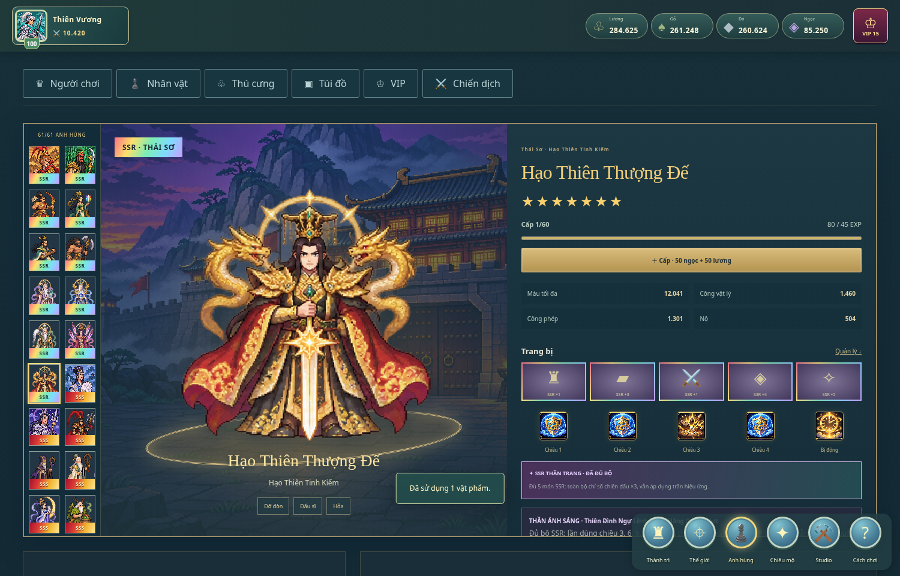
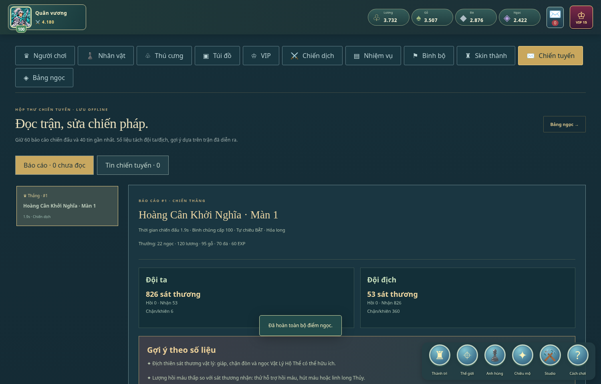
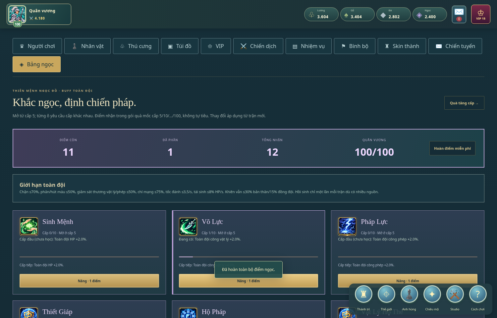
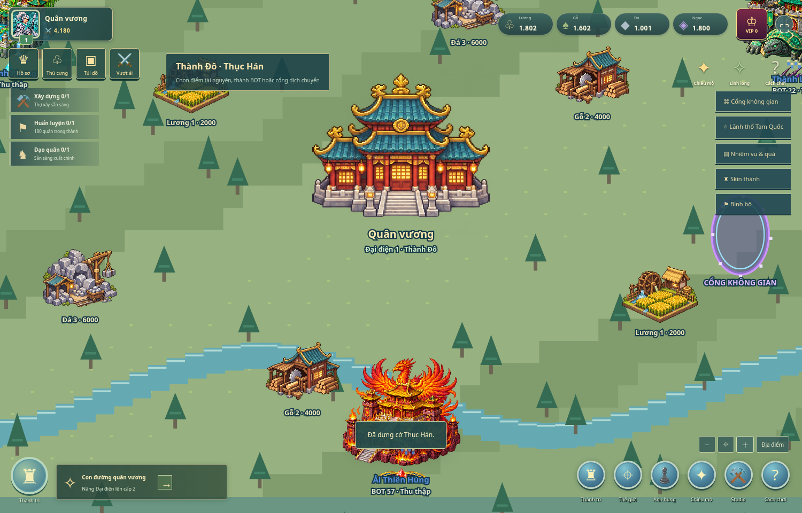
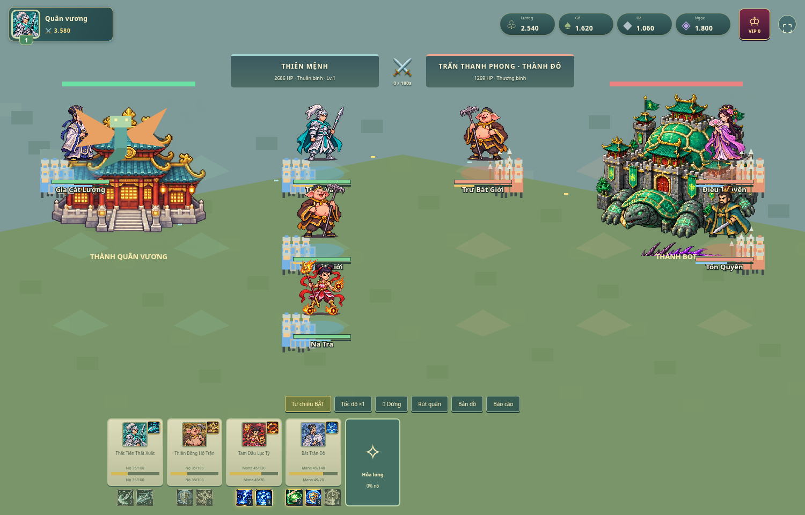
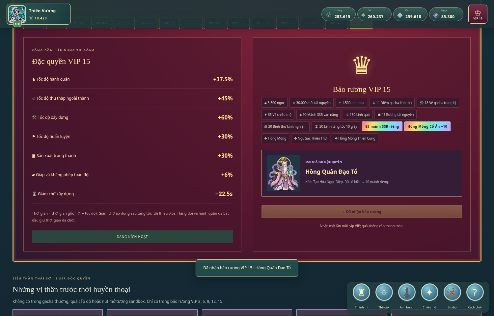

## Bản v12 · Tiên thành, thương mại và điện thoại

- [APK Android thử nghiệm](Thien-Menh-v12-Android.apk): đóng gói offline, có mã Bluetooth LE; đã biên dịch và xác minh chữ ký, chưa kiểm tra trên điện thoại thật.
- [Dự án iPhone/iPad cho Xcode](Thien-Menh-v12-iOS-Project.zip): có lõi game, ảnh và CoreBluetooth; cần Mac/Xcode để biên dịch, ký và cài. Chưa có IPA đã ký.
- [ZIP Windows v12](Thien-Menh-Kingdom-v12-Windows.zip): giải nén và mở CHOI-NGAY.bat hoặc HTML bằng Chrome/Edge.

Cảnh thành có tường/cổng/cầu liền khung, núi rừng và ngày đêm theo giờ thiết bị. Chiêu mộ 10/100 hiện cả lô thẻ cùng lúc; hộp mảnh và hiệu ứng chiến đấu dùng ảnh pixel mới. Thành di chuyển theo khoảng cách và có hình ảo chịu 5 lượt đánh. Vàng, đấu giá và thư thu hộ hoạt động trong phòng tối đa 4 người với máy chủ giữ đặt cọc. Chế độ nhiều thẻ trên PC để kiểm thử được ghi rõ riêng với Bluetooth.

235 kiểm thử và luồng hai phiên trình duyệt đạt. Bluetooth Android↔iOS **chưa thử trên phần cứng thật**; dự án iOS **chưa được Xcode biên dịch**. Hướng dẫn: [mobile/README.md](mobile/README.md), luật và giới hạn: [docs/v12-update.md](docs/v12-update.md).

## Bản v11 · Dân sinh, săn bắt và thành trì sống động

[Tải ZIP Windows offline v11](https://github.com/Corgi-coder99/Game-studio/blob/codex/thien-menh-offline/Thien-Menh-Kingdom-v11-Windows.zip) → **Download raw** → giải nén → mở **CHOI-NGAY.bat** hoặc **Thien-Menh.html** bằng Chrome/Edge. Chạy offline, không cần AI, Node.js hay Python.

Sản xuất cần giao dân và cấp thức ăn; thu hoạch bằng tay. Đại điện tăng dân số, Kĩ thuật có nhánh sản xuất, Linh Dược Viện cứu thương binh. Ba loài thú ngoài thế giới có thể săn bằng đội hình trong khi đội khác và tháp vẫn hoạt động độc lập. Bảng ngọc có 26 hình riêng, Túi đồ/Cửa hàng dùng icon khác nhau; rồng, thú và dân dùng hoạt ảnh nhiều khung. Thành có tường bao/cổng trên trục đường, cây cối và dân cư. Chiêu mộ đổi sang quảng trường với cổng trung tâm và chuyển cảnh mở cửa.

Chi tiết cách chơi và giới hạn: [docs/v11-update.md](docs/v11-update.md). 217 kiểm thử đạt; kiểm tra bản offline bằng Chromium và Python trên Linux. BAT chưa được chạy trên Windows. Các bản cũ được giữ bên dưới.

## Bản v10 · Ba đội song song, chiến đấu theo lượt và bảy long linh

[Tải ZIP Windows offline v10](https://github.com/Corgi-coder99/Game-studio/blob/codex/thien-menh-offline/Thien-Menh-Kingdom-v10-Windows.zip) → **Download raw**. Giải nén → **CHOI-NGAY.bat** hoặc mở **Thien-Menh.html** bằng Chrome/Edge. Chạy offline, không cần AI, Node.js hay Python.

Ba đội thế giới có thể thu thập, tiến công và trấn thủ trong khi đội tháp riêng vẫn chạy. Hai phe hành động theo ô đội hình; bấm kỹ năng để xếp vào lượt của tướng. Trang bị có hình theo tám phẩm cấp; cửa hàng bán hộp mảnh có màu phẩm, mảnh long và mảnh tướng VIP. Điện Long Linh có bảy hệ, chỉ một long được chọn có hiệu lực; Ánh sáng/Bóng tối mở từ quà VIP13/14. Cảnh thành có nhà dân, chợ, dân thu hoạch, chim và rồng; thi công và triệu hồi có chuyển cảnh mới.

Chi tiết luật và kiểm thử: [docs/v10-update.md](docs/v10-update.md). Các phần dưới ghi lại những bản cập nhật trước.

## Bản v9 · Nhiệm vụ, Kĩ thuật và bản đồ

Bản v9 được lưu trong workspace, chưa xuất bản lên GitHub → **Download raw** → giải nén → **CHOI-NGAY.bat**.

Thanh dưới có Anh hùng, Túi đồ, Nhiệm vụ và Bí cảnh với hình nhận diện. VIP nằm trong Người chơi. Nhiệm vụ hiển thị tiến độ, quà và nút nhận; Bảng ngọc là lưới biểu tượng có chú thích. Kĩ thuật gồm sáu nghiên cứu bằng tài nguyên, tác động thực tế đến bộ binh và chiến tranh thành trì. Bấm công trình Thiên Tháp trong thành để vượt 999 tầng. Thế giới có nền đúng tỷ lệ hơn, điểm khai thác và cổng đá phép thuật mới.

Chi tiết: [docs/v9-update.md](docs/v9-update.md). Giữ bản lưu cũ và các quy tắc v8 bên dưới.

## Bản v8 · Công trình và thế giới pixel mới

[Tải ZIP Windows offline v8](https://github.com/Corgi-coder99/Game-studio/blob/codex/thien-menh-offline/Thien-Menh-Kingdom-v8-Windows.zip) → **Download raw** → giải nén → **CHOI-NGAY.bat**. Không cần Node.js, AI hay Internet để chơi.

Đội hình tối đa 4 tướng; công trình cấp 100; bốn hàng đợi luyện quân riêng. Cảnh nền riêng cho các công trình và ba vùng thế giới, đủ 10 hình skin, lính có bước đi, chuyển động/hiệu ứng chiêu, thanh kỹ năng cạnh tướng, đài chiêu mộ có hình, Thiên Tháp 999 tầng và các nút Max kiểm thử offline.

Chi tiết luật, tương thích bản lưu, số đo và giới hạn: [docs/v8-update.md](docs/v8-update.md).

Bản v7 bổ sung dải tướng kéo ngang dưới trận đồ, ba bộ đội hình lưu sẵn, phân bổ/tự điền quân thật và chiến báo hai phe. Nút Thế giới mở lớp thu thập/cổng/bí cảnh trước.

## Giao diện v7 · 1920×1080

[Tải ZIP offline v7](https://github.com/Corgi-coder99/Game-studio/blob/codex/thien-menh-offline/Thien-Menh-Kingdom-v7-Windows.zip) → Download raw → giải nén → CHOI-NGAY.bat. Không cần Node.js. Python là cách chạy tùy chọn.

Túi lưới biểu tượng, mô tả bật khi bấm hình, trang bị có hình và ấn quang/ám, tướng căn giữa, thẻ thú nguyên vẹn, gợi ý đội hình và rồng phía sau. Chiến dịch tự chuyển ải, không bật kết quả hay tạo chiến báo PVE; chỉ công thành thế giới có chiến báo. Hai lớp bản đồ tổng quan/cận cảnh giữ thu thập và cổng dịch chuyển.

Quy chuẩn và giới hạn: [docs/v7-interface.md](docs/v7-interface.md).

## Bản giao diện v6

[Tải ZIP Windows offline](https://github.com/Corgi-coder99/Game-studio/blob/codex/thien-menh-offline/Thien-Menh-Kingdom-v6.1-Windows.zip). Bấm Download raw, giải nén rồi mở CHOI-NGAY.bat hoặc mở Thien-Menh.html bằng Edge/Chrome. Không cần Node.js. Có thể chạy chay_game.py nếu đã có Python.

Giao diện vừa màn hình, chuyển trang thay cuộn; cửa sổ hình nhân, kho trang bị trực quan, quà VIP và mảnh tướng trong túi, nền pixel cho các cửa sổ và hình tướng thống nhất giữa thẻ/đội hình/chi tiết. Chi tiết tại [docs/v6-interface.md](docs/v6-interface.md).

# Thiên Mệnh — Pixel Kingdom v5

Game chiến thuật pixel 2D tiếng Việt, chơi offline trên Windows. Xây thành, xếp đội 3×3, kết hợp nhân vật Trung Hoa và linh long trong PvE. Không cần Node.js, tài khoản, API key hoặc Internet khi chơi.

## Tải và chơi

Mở **[Thien-Menh-Kingdom-v5-Windows.zip](Thien-Menh-Kingdom-v5-Windows.zip)** → **Download raw file** → **Extract All / Giải nén tất cả**.

- Chạy `CHOI-NGAY.bat` để mở bằng Edge/Chrome. Có thể kéo `Thien-Menh.html` vào trình duyệt.
- Hoặc chạy `CHAY-BANG-PYTHON.bat` / `py -3 chay_game.py`. Python dùng thư viện chuẩn, không cần pip. Giữ cửa sổ dòng lệnh khi chơi; Ctrl+C để dừng.

## Nội dung v5

- **999 màn chiến dịch:** nối màn/cày lại, tốc độ ×1/×2/×4, tự nhận EXP và thưởng.
- **Tam Quốc:** chọn quốc gia/thành ban đầu; Ngụy đỏ tăng Kỵ, Thục xanh biển tăng Thương, Ngô xanh lá tăng Cung.
- **Bản đồ khu vực:** 27 thành BOT có AI kinh tế/quân sự offline, 54 điểm thu thập, cổng dịch chuyển. Công thành có quân, hai thành trì và HP.
- **Nhiệm vụ và quà thời gian:** EXP/thắng PvE, thu thập, chuỗi thắng/thua 100, danh hiệu và quà xây thành; thời gian chỉ tính lúc tab game hiển thị.
- **10 skin thành:** gồm 3 skin nhiệm vụ và 3 thiết kế độc quyền VIP13/14/15. Chỉ skin đang trang bị cho buff.
- **Binh chủng cấp 1–100:** Thuẫn/Thương/Cung/Kỵ tự theo cấp người chơi, có bảng chỉ số từng cấp và hệ số thực trong trận.
- **Hộp thư chiến tuyến:** báo cáo 60 trận gần nhất, số liệu từng tướng/linh long, sát thương, hồi phục, khiên, kỹ năng và gợi ý nâng theo trận.
- **26 ô bảng ngọc:** mở dần cấp 5–100; nhận điểm từ quà mốc cấp. Buff toàn đội, nâng theo lựa chọn và hoàn điểm miễn phí.
- **Bí cảnh và truyền thừa:** mảnh bản đồ giấu tại điểm thu thập chỉ vị trí 6 cổng ẩn; thắng BOSS, nhận bí kíp qua thư và thêm một ô kỹ năng dùng cho mọi tướng. Sáu hiệu ứng mới: phi kiếm, na di, hóa thân, luân hồi, mượn thuộc tính, liên kết HP.
- **61 nhân vật:** 56 tướng thường và 5 SSR Thái Sơ chỉ nhận tại VIP 3/6/9/12/15. SSR ngũ sắc; SSS đỏ vàng; SS vàng; S đỏ; A cam; B tím; C xanh biển đậm; D xanh lá.
- **202 kỹ năng chủ động gốc có biểu tượng:** mỗi tướng có 3, SSS/SSR có 4; năm tướng VIP có thêm bị động riêng. Cấp kỹ năng, hồi chiêu và tiêu hao độc lập; có tự động hoặc bấm thủ công.
- **7 sao nhân vật:** quay trùng nhận mảnh đúng tướng. Mỗi sao tăng 8% HP, hai công và hai kháng. Mảnh vạn năng chỉ dùng cho SSR.
- **5 ô trang bị**, đủ 8 phẩm cấp; SSR có chỉ số vượt trội và xuyên giáp, xuyên kháng phép, né tránh, sát thương chí mạng hoặc kháng thời gian debuff. Đủ 5 món SSR tăng chỉ số ×3 và kích hoạt THẦN sau mỗi 3 lần dùng chiêu.
- **THẦN Ánh sáng:** miễn sát thương 1 giây, hồi máu. **Bóng tối:** xóa buff có thời hạn của địch, sát thương theo thời gian, tăng 50% thời gian/cường độ debuff. Đường THẦN cố định theo diễn giải điển tích từng tướng.
- **Hồ sơ người chơi** cấp 1–100; quà mỗi 5 cấp. Từ 50 có vé, thần trang và ngoại trang; mỗi mốc từ 60 bảo đảm SSR thường.
- **VIP 0–15 miễn phí**, điểm kiếm từ tăng cấp người chơi. Quà nhận một lần; đặc quyền tác động thật đến hành quân, thu thập, xây dựng, huấn luyện, sản xuất và phòng thủ.
- **Gacha tướng / trang bị / thú cưng riêng**. Điểm quay thú chỉ có trong quà VIP. Năm linh thú tối đa 5 sao và cấp 20; thức tỉnh sao 5 đổi hình ảnh và mở hiệu ứng riêng.
- **Túi Càn Khôn** thống kê tài nguyên, vật phẩm, trang bị, mảnh, linh thú, ngoại trang và công dụng. Kho trang bị không còn giới hạn 500 ô; danh sách phân trang.
- Giữ thành phố toàn màn hình, 4 binh chủng, xây dựng/huấn luyện có thời gian, 3 trại PvE, thu thập, 8 liên kết điển tích, 3 linh long và hiệu ứng canvas.













## Cách thử nhanh

Nhấp chân dung góc trên trái để mở **Người chơi**. Các tab mở Nhân vật, Thú cưng, Túi đồ và VIP.

Trong **Studio**, chọn **Vật tư phát triển nhân vật** để thử 56 tướng thường. Chọn **Sandbox: đạt cấp 100 / VIP15**, sau đó nhận quà ở Hồ sơ và VIP để thử năm SSR độc quyền, điểm quay thú, trang bị và ngoại trang. Các nút sandbox không tự phát SSR VIP hoặc điểm quay thú.

Vào **Anh hùng → Chi tiết** để xem màn nhân vật, tăng cấp/sao, nâng từng chiêu và đeo đồ. Chọn ô trên bàn 3×3 rồi chọn tướng để xếp đội. Xuất chinh cần 60 quân cùng binh chủng.

## Lưu tiến độ

Game lưu bằng trình duyệt; **Studio → Xuất bản lưu JSON** để sao lưu. Dùng Nhập bản lưu khi đổi máy, trình duyệt, cổng Python hoặc chuyển giữa HTML và Python vì các cách chạy có vùng lưu riêng. Bản v1–v4 được bổ sung trường mới, giữ tướng, tiền và trang bị; đạo quân đang đi được thu hồi khi nạp lại. Giao chiến không chạy khi đóng game; sản xuất vắng mặt tối đa 8 giờ.

Túi không áp giới hạn số ô trang bị; dung lượng lưu thực tế phụ thuộc trình duyệt. Nếu trình duyệt báo không lưu được, xuất JSON trước khi đóng. Không dùng chế độ riêng tư để lưu lâu dài.

## Phát triển

Node.js 22+, không cần cài thư viện:

```sh
npm test
npm run dev
npm run build:offline
python3 package-windows.py
```

171 kiểm thử; xem [kết quả kiểm tra](docs/validation.md), [thiết kế v5](docs/v5-systems.md) và [toàn bộ nhân vật/kỹ năng](docs/characters.md). Đọc [AGENTS.md](AGENTS.md) trước khi sửa.

Đây là prototype PvE độc lập; chưa có PvP, liên minh, tài khoản hoặc thế giới MMO. Công thức chiến đấu là thiết kế riêng, không khẳng định là công thức Infinity Kingdom. Ảnh là tài sản tạo riêng cho dự án; sprite tĩnh có chuyển động và hiệu ứng canvas, chưa có bộ hoạt ảnh nhiều khung. BAT chưa được chạy trên Windows thật; Python và Chromium được kiểm tra trên Linux.

Studio không gọi AI khi chơi hoặc điều khiển Codex trực tiếp. Quy trình studio gọn lấy cảm hứng từ [Claude Code Game Studios](https://github.com/Donchitos/Claude-Code-Game-Studios).
